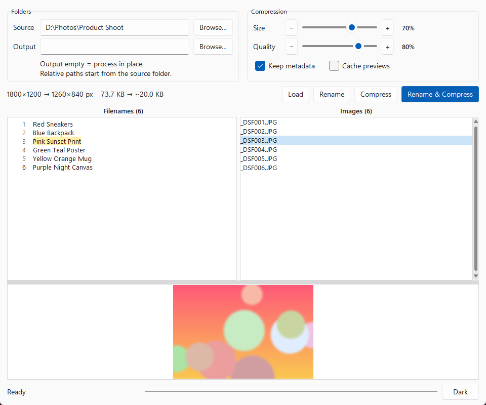
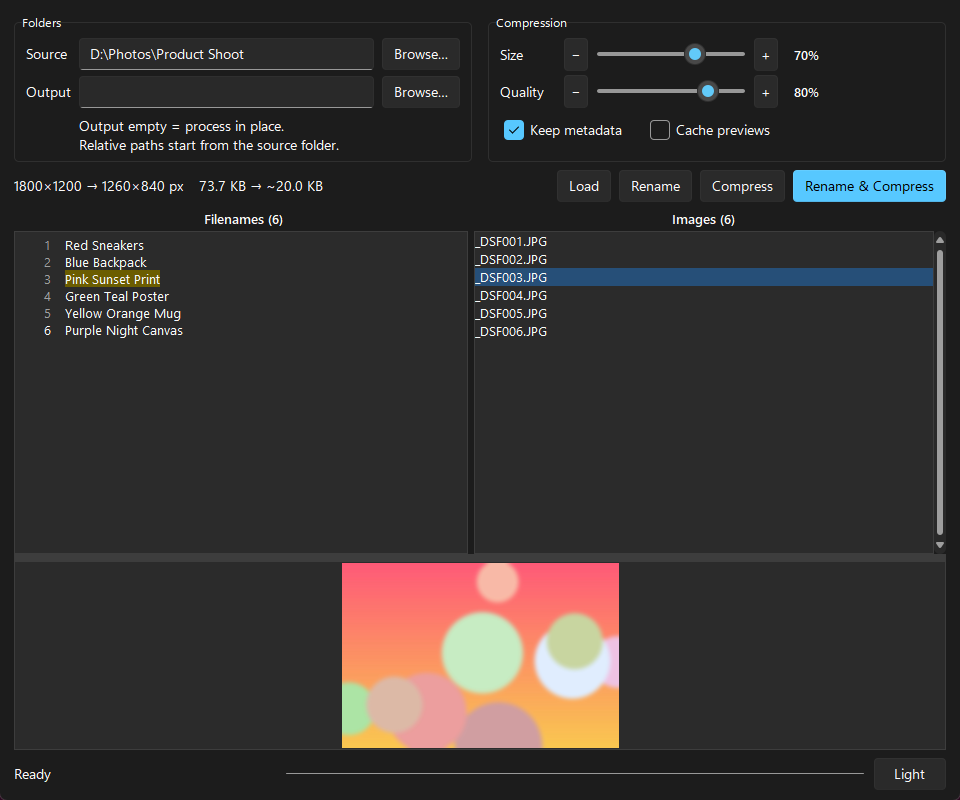

# Image Renamer

A small desktop app (Python + Tkinter) that renames and compresses photos in bulk.

Paste a list of names (one per line), load a folder, and the images
(`.png`, `.jpg`, `.jpeg`, sorted by file name) are renamed in order to the sanitized
names. It can also resize and recompress them in the same pass.

- Rename, compress, or both at once (**Rename & Compress**, **Rename**, **Compress**)
- Resize and quality sliders with a live output-size estimate
- Optional output folder (empty = process in place), optional metadata keep
- Image preview with a cached preview store for fast browsing
- Light and dark theme

| Light | Dark |
|-------|------|
|  |  |

_Screenshots use generated sample images._

## Contents

1. [Download](#1-download)
2. [Run from source](#2-run-from-source)
3. [Build the executable yourself](#3-build-the-executable-yourself)
4. [Release automation](#4-release-automation)
5. [Releasing a new version](#5-releasing-a-new-version)
6. [Setting the automation up from scratch](#6-setting-the-automation-up-from-scratch)
7. [Troubleshooting](#7-troubleshooting)

---

## 1. Download

Prebuilt binaries are attached to every [GitHub release](../../releases):

| Platform | File |
|----------|------|
| Windows (x86-64) | `ImageRenamer-<version>-windows-x86_64.exe` |
| Linux (x86-64) | `ImageRenamer-<version>-linux-x86_64` |

Verify a download against `SHA256SUMS` from the same release:

```bash
sha256sum -c SHA256SUMS --ignore-missing
```

On Linux, make it executable first: `chmod +x ImageRenamer-*-linux-x86_64`.
The Windows `.exe` is not code-signed, so SmartScreen may warn on first launch
(**More info → Run anyway**).

## 2. Run from source

Requirements: Python 3.10+ with Tkinter.

```bash
git clone https://github.com/mabayhan/image-renamer-py.git
cd image-renamer-py
python -m venv .venv
source .venv/bin/activate          # Windows: .venv\Scripts\activate
pip install -r requirements.txt
python main.py
```

Tkinter ships with the Windows and macOS installers from python.org. On Linux it
is a separate package:

```bash
sudo apt install python3-tk        # Debian / Ubuntu
sudo dnf install python3-tkinter   # Fedora
```

`sv-ttk` (in `requirements.txt`) is optional. It gives the modern Windows 11 look;
the app falls back to plain ttk without it.

## 3. Build the executable yourself

The app is frozen into a single file with [PyInstaller](https://pyinstaller.org).
PyInstaller cannot cross-compile, so you build each platform on that platform,
or use the Docker recipes below.

### 3a. Native build (Windows or Linux)

```bash
python -m venv .venv
source .venv/bin/activate          # Windows: .venv\Scripts\activate
pip install -r requirements-build.txt
pyinstaller --noconfirm --onefile --windowed --name ImageRenamer main.py
```

Result: `dist/ImageRenamer.exe` (Windows) or `dist/ImageRenamer` (Linux).

### 3b. Docker build (Linux binary, from any machine with Docker)

```bash
docker build -t image-renamer-linux -f build/Dockerfile.linux build
docker run --rm -v "$PWD":/src -e APP_VERSION=dev -e HOST_UID=$(id -u) -e HOST_GID=$(id -g) image-renamer-linux
# -> dist/ImageRenamer-dev-linux-x86_64
```

### 3c. Docker build (Windows .exe, cross-built on Linux)

This runs Windows Python under [Wine](https://www.winehq.org/) inside a container,
so no Windows machine is needed. The first build is slow (it installs Wine and
Windows Python); later builds reuse the Docker layer cache.

```bash
docker build -t image-renamer-windows -f build/Dockerfile.windows build
docker run --rm -v "$PWD":/src -e APP_VERSION=dev -e HOST_UID=$(id -u) -e HOST_GID=$(id -g) image-renamer-windows
# -> dist/ImageRenamer-dev-windows-x86_64.exe
```

These are exactly the commands the automated pipeline runs.

## 4. Release automation

Development happens on a self-hosted [Forgejo](https://forgejo.org) server, and
GitHub is the public mirror. You never push to GitHub or build by hand:

```
 you ── git push + git tag vX.Y.Z ──▶ Forgejo (private)
                                          │  tag push triggers
                                          ▼
                              Forgejo Actions workflow
                              .forgejo/workflows/release.yaml
                                          │  SSH to the build host
                                          ▼
                    build/ci-build.sh on the container host (Docker)
                      1. clone the tagged commit
                      2. build Linux binary   (build/Dockerfile.linux)
                      3. build Windows .exe   (build/Dockerfile.windows, Wine)
                      4. write SHA256SUMS, keep a copy on the host
                      5. publish a Forgejo release with all files
                      6. push main + the tag to GitHub
                      7. publish the GitHub release with the same files
```

| File | Role |
|------|------|
| `.forgejo/workflows/release.yaml` | Trigger (`v*` tag or manual run). Opens an SSH session to the build host and runs the script below. |
| `build/ci-build.sh` | Does the whole job on the build host: clone, build both platforms, checksums, Forgejo release, GitHub push and release. |
| `build/Dockerfile.linux`, `build/build-linux.sh` | Linux builder image and its PyInstaller step. |
| `build/Dockerfile.windows`, `build/build-windows.sh` | Windows builder image (Wine + Windows Python) and its PyInstaller step. |

The version comes from the tag: `v1.2.0` produces
`ImageRenamer-1.2.0-windows-x86_64.exe` and `ImageRenamer-1.2.0-linux-x86_64`.
Running the workflow manually (no tag) builds and keeps the artifacts on the host
but does not publish a release.

## 5. Releasing a new version

```bash
# 1. change the code, then commit and push to the repo
git add -A
git commit -m "Describe the change"
git push origin main

# 2. tag the release (vMAJOR.MINOR.PATCH) and push the tag
git tag v1.1.0
git push origin v1.1.0
```

That is all. The tag push starts the pipeline, which builds both executables and
publishes the release on Forgejo and on GitHub. Watch progress under the Forgejo
repo's **Actions** tab. A full build takes a few minutes (the first one, which
creates the Wine image, takes longer).

To rebuild a release, delete the tag locally and on the remote, then tag again:

```bash
git tag -d v1.1.0
git push origin :refs/tags/v1.1.0
```

Also delete the release on both Forgejo and GitHub, then re-tag as above.

## 6. Setting the automation up from scratch

Use this when you fork the project and want the same pipeline on your own servers.

**Requirements**

- A Forgejo (or Gitea) server with Actions enabled and a registered runner
  (any runner label that matches `runs-on: ubuntu-latest`).
- A Linux build host with Docker, `git`, `curl`, and SSH access. The runner does
  not build anything itself; it only SSHes into this host.
- A GitHub repo (public) to mirror releases to.

**Steps**

1. Create the repo on Forgejo and push this code to it.
2. Create the empty public repo on GitHub, for example with the GitHub CLI:
   `gh repo create <you>/image-renamer-py --public`.
3. Create the tokens:
   - **Forgejo token** (Settings → Applications) with repository read/write
     scope. It is used to clone the tag on the build host and to publish the
     Forgejo release.
   - **GitHub token** with write access to the mirror repo's contents (a
     fine-grained token limited to that single repo, *Contents: Read and write*,
     is enough).
   - **SSH key** that the runner uses to log in to the build host. Prefer a
     dedicated key (`ssh-keygen -t ed25519 -f deploy_key`) whose public half is in
     the build user's `~/.ssh/authorized_keys`.
4. Add these as **repository secrets** on Forgejo
   (Repo → Settings → Actions → Secrets):

   | Secret | Value |
   |--------|-------|
   | `SSH_HOST` | Hostname or IP of the build host |
   | `SSH_USERNAME` | User on the build host (must be allowed to run `docker`) |
   | `SSH_KEY` | Private SSH key (full contents) |
   | `RELEASE_TOKEN` | Forgejo token from step 3 |
   | `GH_TOKEN` | GitHub token from step 3 |

   If `GH_TOKEN` is not set, the pipeline skips the GitHub step and only
   publishes on Forgejo.
5. If your GitHub repo is not `mabayhan/image-renamer-py`, set the target by
   exporting `GH_REPOSITORY='<you>/<repo>'` in `release.yaml` next to the other
   `export` lines, or change the default in `build/ci-build.sh`.
6. Do a trial run: Forgejo repo → **Actions** → *release* → **Run workflow**.
   It builds both binaries without publishing anything. Then tag a release as in
   [section 5](#5-releasing-a-new-version).

Build artifacts are also kept on the build host in
`/config/image-renamer-py-dist/<version>/` (change with the `DIST_ROOT` variable
in `build/ci-build.sh`).

## 7. Troubleshooting

| Symptom | Likely cause |
|---------|--------------|
| Workflow never starts | Actions disabled on the repo, or no runner online with a matching label. |
| `Permission denied (publickey)` in the workflow | `SSH_KEY` is not authorized for `SSH_USERNAME` on `SSH_HOST`. |
| `permission denied ... docker.sock` | The SSH user is not in the `docker` group. |
| Forgejo release exists but GitHub step failed | `GH_TOKEN` missing, expired, or lacks write access; fix it and re-run the workflow for the tag. |
| Windows build fails during `wineboot` or `pip install` | Network access to dl.winehq.org / nuget.org / PyPI from the build host; retry. |
| `Permission denied` on `dist/` files | The container ran as root; pass `HOST_UID`/`HOST_GID` as in section 3 so the output is handed back to your user. |
| Linux binary will not start | Needs a desktop session with X11 or Wayland (it is a GUI app). |
